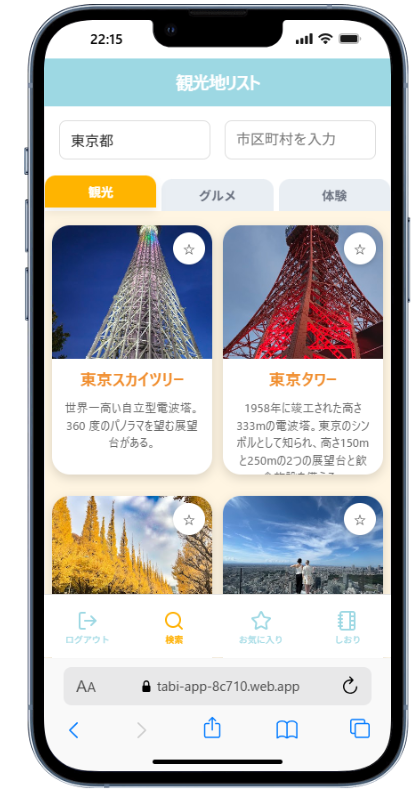
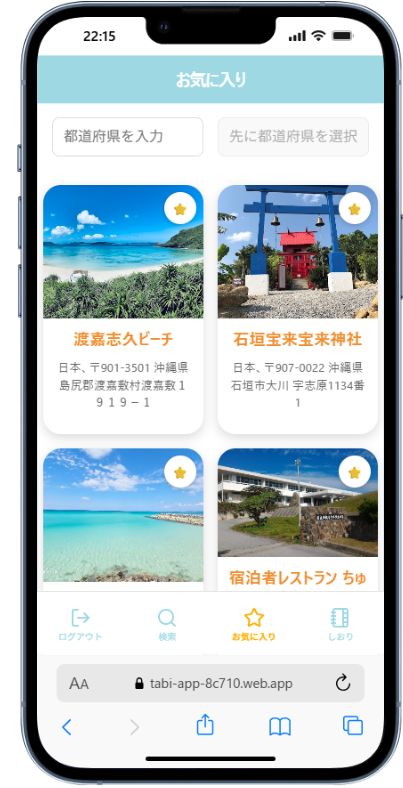
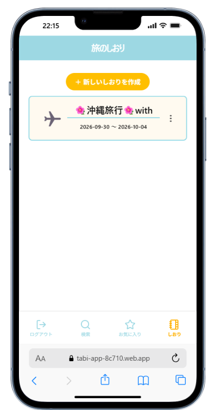
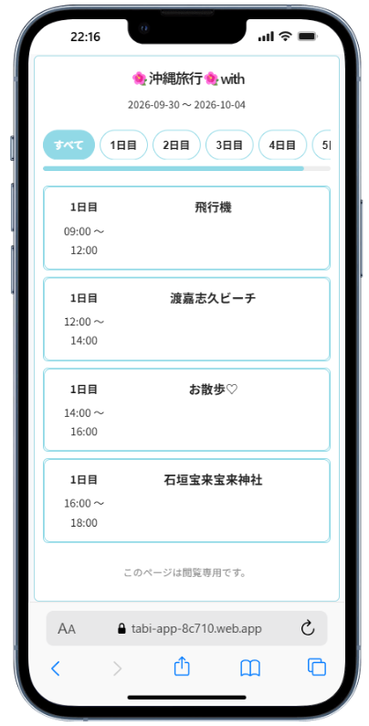

# Tabi-app ✈️

旅行先のスポット検索から、お気に入り登録、旅行プランの作成・共有までできる旅行計画アプリです。

**アプリURL：** https://tabi-app-8c710.web.app

## 📱 アプリ画面

### ① スポット検索
観光・グルメ・体験のカテゴリーから、旅行先のスポットを検索できます。



### ② お気に入り
気になるスポットをお気に入りに登録して、一覧で確認できます。



### ③ 旅行プラン一覧
作成した旅行プランを一覧で確認できます。



### ④ 旅行プラン詳細
日ごとのスケジュールを作成・管理できます。



## ✨ 主な機能

- **スポット検索**：都道府県・市区町村を指定して観光スポットや飲食店、体験施設を検索
- **お気に入り登録**：気になるスポットを保存・削除
- **旅行プラン作成**：旅行の日程やタイトルを登録・編集・削除
- **スケジュール管理**：お気に入りのスポットを旅行日程に追加し、時間ごとの予定を管理
- **プラン共有**：URLを使って旅行プランを共有。共有先では閲覧のみ可能

## 🛠 使用技術

| 分類               | 技術                                      |
| ------------------ | ----------------------------------------- |
| フロントエンド     | React 19 / TypeScript                     |
| ビルドツール       | Vite 8                                    |
| CSS                | Emotion                                   |
| ルーティング       | React Router 7                            |
| 認証・データベース | Firebase Authentication / Cloud Firestore |
| 外部API            | Google Places API / HeartRails Geo API    |
| その他             | Wanakana / Oxlint                         |

## 💡 実装で工夫した点

- Reactのコンポーネントを機能ごとに分割し、再利用しやすい構成を意識
- Firebase Authenticationを利用したユーザー認証
- Firestoreを利用したユーザーごとのデータ管理
- Google Places APIを利用したスポット検索
- 旅行プランの作成からスケジュール管理、共有まで一連の操作ができる設計
- スマートフォンでの利用を考慮したレスポンシブ対応

## 🚀 ローカル環境での起動方法

### 1. リポジトリをクローン

```bash
git clone https://github.com/Kubowaka/Tabi-app.git
cd Tabi-app
```

### 2. パッケージをインストール

```bash
npm install
```

### 3. 環境変数を設定

プロジェクト直下に `.env` ファイルを作成し、FirebaseおよびGoogle Places APIの設定値を入力してください。

必要な環境変数は `.env.example` を参照してください。

### 4. 開発サーバーを起動

```bash
npm run dev
```

### 5. ビルド

```bash
npm run build
```

## 🌐 公開URL

https://tabi-app-8c710.web.app

## 📂 GitHub

https://github.com/Kubowaka/Tabi-app
